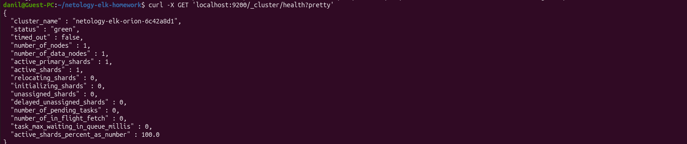
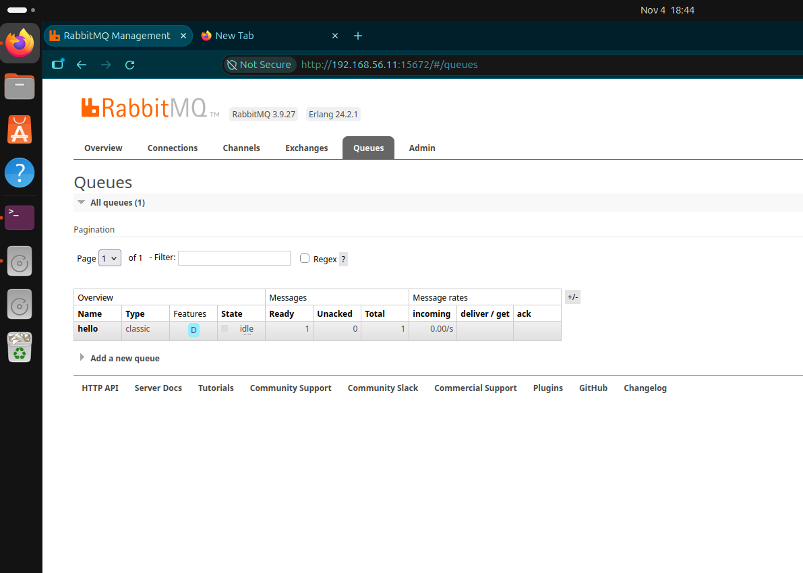
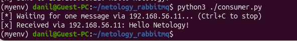
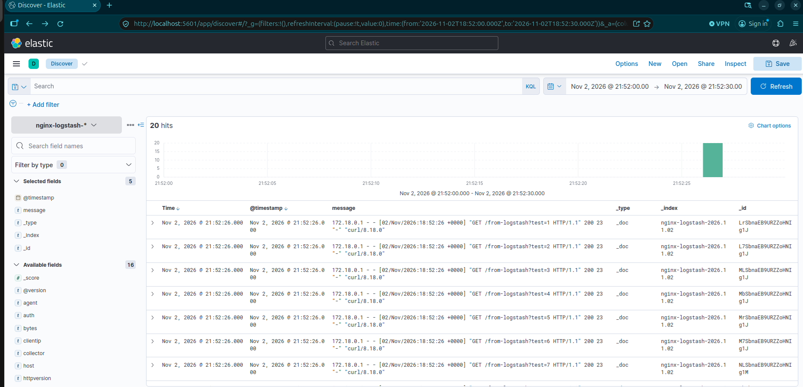
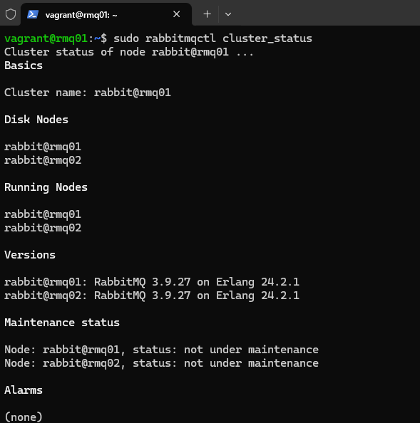
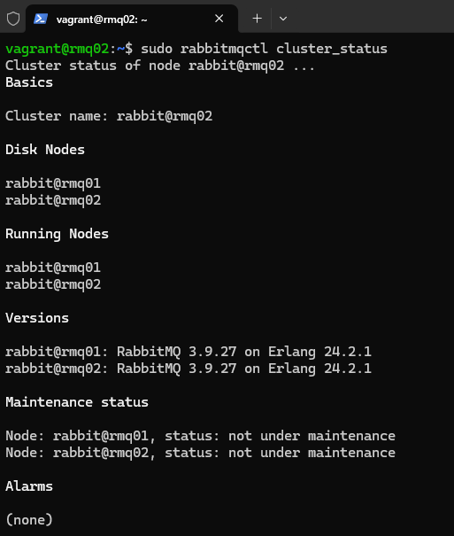
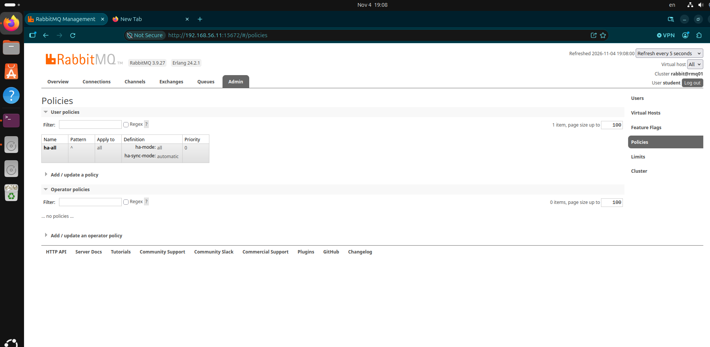
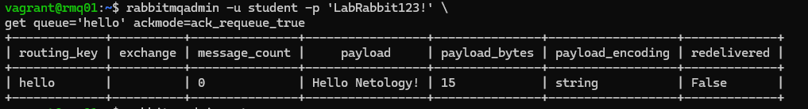
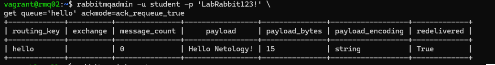
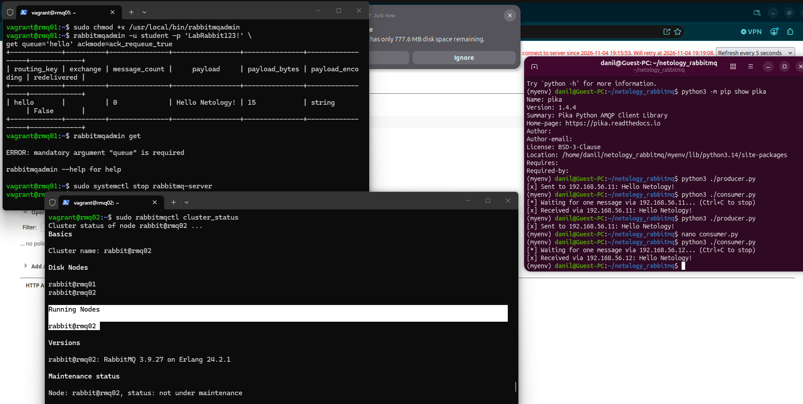

# Домашнее задание к занятию "`Очереди RabbitMQ`" - `<Березкин Даниил>`

### Задание 1

`Главная страница RabbitMQ Management`

`


---

### Задание 2

`Очередь hello в веб-интерфейсе с одним сообщением в Ready`

`

`Вывод consumer.py с полученным сообщением.`

`

---

### Задание 3

`Две ноды в веб-интерфейсе`

`

`Вывод cluster_status rmq01`

`

```

vagrant@rmq01:~$ sudo rabbitmqctl cluster_status
Cluster status of node rabbit@rmq01 ...
Basics

Cluster name: rabbit@rmq01

Disk Nodes

rabbit@rmq01
rabbit@rmq02

Running Nodes

rabbit@rmq01
rabbit@rmq02

Versions

rabbit@rmq01: RabbitMQ 3.9.27 on Erlang 24.2.1
rabbit@rmq02: RabbitMQ 3.9.27 on Erlang 24.2.1

Maintenance status

Node: rabbit@rmq01, status: not under maintenance
Node: rabbit@rmq02, status: not under maintenance

Alarms

(none)

Network Partitions

(none)

Listeners

Node: rabbit@rmq01, interface: [::], port: 25672, protocol: clustering, purpose: inter-node and CLI tool communication
Node: rabbit@rmq01, interface: [::], port: 5672, protocol: amqp, purpose: AMQP 0-9-1 and AMQP 1.0
Node: rabbit@rmq01, interface: [::], port: 15672, protocol: http, purpose: HTTP API
Node: rabbit@rmq02, interface: [::], port: 15672, protocol: http, purpose: HTTP API
Node: rabbit@rmq02, interface: [::], port: 25672, protocol: clustering, purpose: inter-node and CLI tool communication
Node: rabbit@rmq02, interface: [::], port: 5672, protocol: amqp, purpose: AMQP 0-9-1 and AMQP 1.0

Feature flags

Flag: drop_unroutable_metric, state: enabled
Flag: empty_basic_get_metric, state: enabled
Flag: implicit_default_bindings, state: enabled
Flag: maintenance_mode_status, state: enabled
Flag: quorum_queue, state: enabled
Flag: stream_queue, state: enabled
Flag: user_limits, state: enabled
Flag: virtual_host_metadata, state: enabled

```


`Вывод cluster_status rmq02`

`


```

vagrant@rmq02:~$ sudo rabbitmqctl cluster_status
Cluster status of node rabbit@rmq02 ...
Basics

Cluster name: rabbit@rmq02

Disk Nodes

rabbit@rmq01
rabbit@rmq02

Running Nodes

rabbit@rmq01
rabbit@rmq02

Versions

rabbit@rmq01: RabbitMQ 3.9.27 on Erlang 24.2.1
rabbit@rmq02: RabbitMQ 3.9.27 on Erlang 24.2.1

Maintenance status

Node: rabbit@rmq01, status: not under maintenance
Node: rabbit@rmq02, status: not under maintenance

Alarms

(none)

Network Partitions

(none)

Listeners

Node: rabbit@rmq01, interface: [::], port: 25672, protocol: clustering, purpose: inter-node and CLI tool communication
Node: rabbit@rmq01, interface: [::], port: 5672, protocol: amqp, purpose: AMQP 0-9-1 and AMQP 1.0
Node: rabbit@rmq01, interface: [::], port: 15672, protocol: http, purpose: HTTP API
Node: rabbit@rmq02, interface: [::], port: 15672, protocol: http, purpose: HTTP API
Node: rabbit@rmq02, interface: [::], port: 25672, protocol: clustering, purpose: inter-node and CLI tool communication
Node: rabbit@rmq02, interface: [::], port: 5672, protocol: amqp, purpose: AMQP 0-9-1 and AMQP 1.0

Feature flags

Flag: drop_unroutable_metric, state: enabled
Flag: empty_basic_get_metric, state: enabled
Flag: implicit_default_bindings, state: enabled
Flag: maintenance_mode_status, state: enabled
Flag: quorum_queue, state: enabled
Flag: stream_queue, state: enabled
Flag: user_limits, state: enabled
Flag: virtual_host_metadata, state: enabled

```

`Политика ha-all с её параметрами`

`


`rabbitmqadmin get на ноде rmq01`

`

`rabbitmqadmin get на ноде rmq02`

`


`Успешное получение сообщения через rmq02 при остановленной rmq01`

`


---
